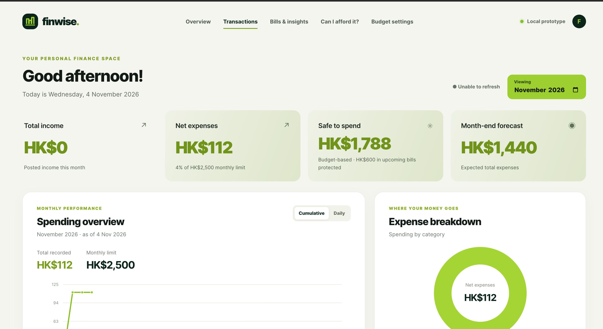
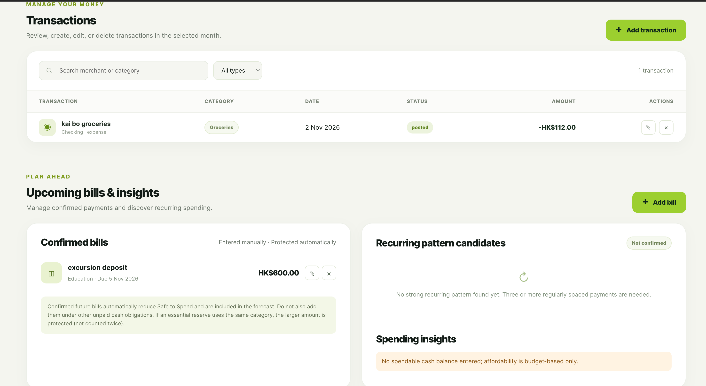
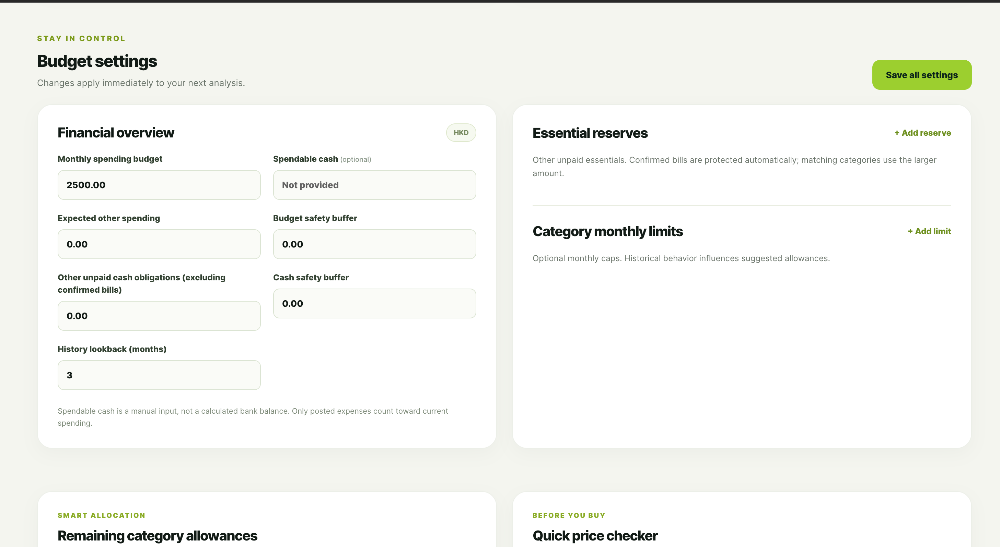
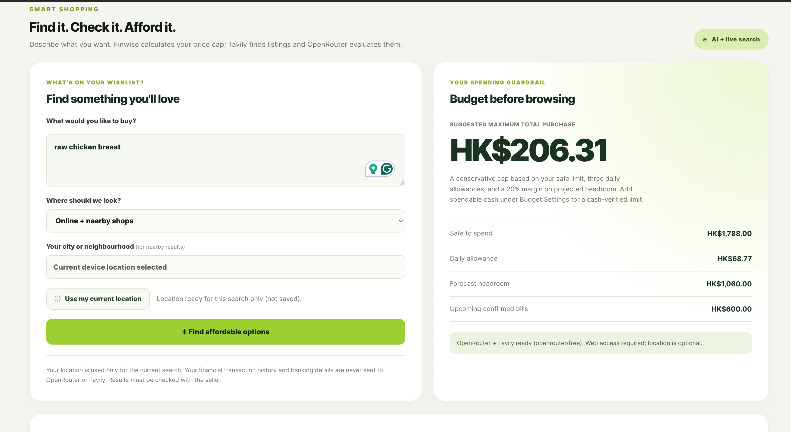
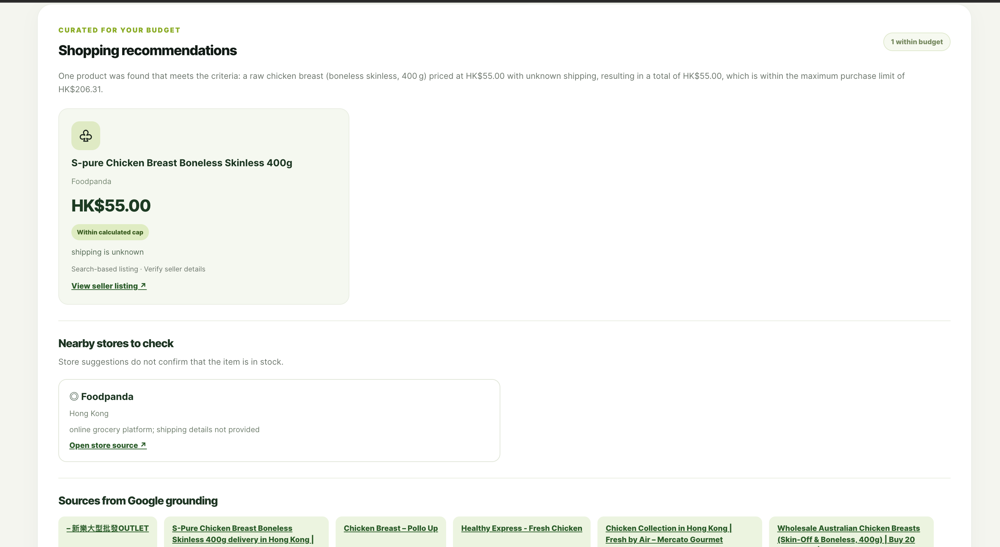

# Finwise — AI-Assisted Personal Finance

**Track your spending. Plan ahead. Know what you can afford.**

Finwise is a personal financial management application that combines expense tracking, forward-looking budget analytics, and AI-assisted shopping recommendations.

Traditional expense trackers tell you **where your money went**. Finwise goes a step further by helping you understand **how much you can safely spend**, considering your spending patterns, upcoming bills, essential expenses, and budget constraints.

The project explores how deterministic financial analysis and generative AI can work together to support everyday financial decisions.

> **Status:** Functional prototype | Under active development

## Features

- **Financial dasboard** — Track income, expenses, budget utilization, and spending trends through interactive visualizations.
- **Smart Budgeting** — Calculate spending velocity, month-end forecasts, daily allowances, and safe-to-spend limits.
- **Expense Management** — Add, edit, categorize, and analyze transactions.
- **Financial Planning** — Protect upcoming bills, configure essential reserves, and identify potential recurring expenses.
- **Affordability Checker** — Evaluate whether a prospective purchase fits within your financial constraints.
- **AI Shopping Assistant** — Discover products within a calculated purchase limit using OpenRouter and Tavily, with optional location-aware suggestions.

## Application Preview

### Financial Overview

Monitor your financial position with real-time budget calculations, spending forecasts, and expense visualizations.



### Transactions & Financial Planning

Manage transactions, track confirmed upcoming bills, and identify potential recurring spending patterns.



### Budget Settings

Customize monthly budgets, spending limits, financial reserves, and safety buffers.



### AI-Assisted Shopping

Describe a product, receive a budget-aware purchase limit, and discover relevant shopping options through AI-assisted search.





## Technology Stack

| Component | Technologies |
|---|---|
| Backend | Python |
| Frontend | HTML, CSS, JavaScript |
| Database | SQLite |
| AI Integration | OpenRouter |
| Product Discovery | Tavily |
| Version Control | Git & GitHub |

## Documentation

Detailed explanations of the application's functionality, technical implementation, and usage are available in the project documentation.

| Resource | Description |
|---|---|
| [Documentation](./finwise_dasboard/docs/) | Technical documentation, architecture, and application guides |
| [Budgeting Engine](./finwise_dasboard/docs/) | Budget calculations, spending forecasts, and affordability logic |
| [Shopping AI](./finwise_dasboard/docs/) | AI shopping workflow, product discovery, and external API integration |
| [User Guide](./finwise_dasboard/docs/) | Application setup, configuration, and usage instructions |
| [Examples](./finwise_dasboard/examples/) | Example workflows and supporting materials |
| [Tests](./finwise_dasboard/tests/) | Application tests |

## Project Structure

```text
finwise/
├── finwise_dasboard/
│   ├── backend/          # Application backend
│   ├── data/             # Data storage
│   ├── docs/             # Technical documentation
│   │   └── images/       # README screenshots
│   ├── examples/         # Example workflows
│   ├── Frontend/         # Web dasboard
│   ├── tests/            # Application tests
│   └── run_dasboard.py  # Application entry point
└── README.md
```

## Project Status

Finwise is an experimental prototype, not a production-ready financial platform. Financial projections depend on recorded data and user-defined assumptions, while AI shopping results depend on external services and should be independently verified.

Future development may include improved forecasting, automated transaction categorization, and more reliable product recommendations.

---

**Finwise — From tracking expenses to making informed spending decisions.**
